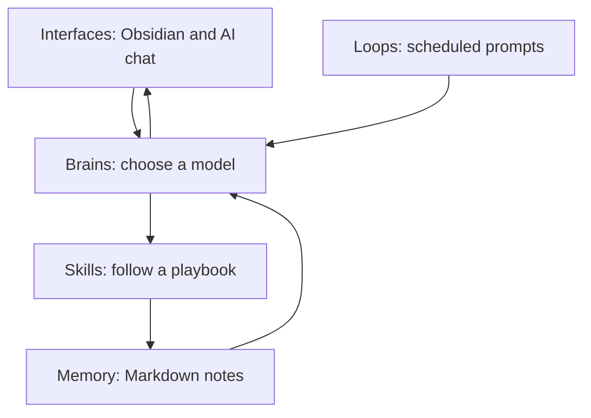

# AI OS

One folder of Markdown notes for running everyday life with AI. Obsidian makes the notes easy to browse. An AI reads the same files and helps keep them current. No coding is needed.

This public demo accompanies a YouTube video by Gus Canales, The Tech Gus. Every personal detail, number, employer, contact and event here is fictional demo data. Snapshot date: 2026-11-22. Future dates are plans. Do not treat this as Gus's private vault.

## What it looks like

The Command Center in Obsidian, no plugins needed (fake demo data):


The whole system on one page, drawn in Excalidraw ([source file](<Diagrams/AI OS Map.excalidraw>)):


## Five layers

| Layer | Meaning | Example |
|---|---|---|
| Memory | Notes that persist between chats | Budget, training log, values |
| Brains | Models chosen for the job | [[Brains]] |
| Skills | Repeatable steps for one job | `.claude/skills/weekly-review/SKILL.md` |
| Loops | Prompts run on a schedule | [[Loops/Weekly Review]] |
| Interfaces | Ways to read or talk to the system | Obsidian, desktop AI, chat, voice capture |



The diagram renders in Obsidian. The table gives the same explanation in plain text.

## Life areas

| Area | What goes in | What the AI does | App it can replace |
|---|---|---|---|
| [[Areas/Money/Money\|Money]] | Budget, balances, spending | Categorizes, flags changes, plans debt payoff | Budgeting apps (YNAB, Monarch) |
| [[Areas/Health/Health\|Health]] | Training, weight, sleep | Tracks progress, spots plateaus, adjusts the plan | Workout apps (Fitbod, Hevy) |
| [[Areas/Career/Career\|Career]] | Applications, interview notes | Screens roles and prepares practice | Job tracker |
| [[Areas/Learning/Learning\|Learning]] | Courses, exam feedback | Plans study and quizzes | Study planner |
| [[Areas/Goals/Goals\|Goals]] | Values, yearly targets | Connects weekly work to goals | Goal tracker |
| [[Areas/Journal/Journal\|Journal]] | Reflections and reviews | Finds recurring themes | Journal app |
| [[Areas/Home/Home\|Home]] | Meals, renewals, maintenance | Plans groceries and reminders | Home organizer |
| [[Areas/People/People\|People]] | Contact dates, gift ideas | Suggests check-ins | Personal contact tracker |
| [[Areas/Projects/Projects\|Projects]] | Video pipeline, side ideas | Finds the next useful step | Project planner |
| [[Areas/Hobbies/Photography\|Hobbies]] | Shoot ideas and gear notes | Plans practice | Hobby notebook |
| [[Tasks]] | Every task, once | Keeps This Week to 7, shows what's due | To-do apps (Todoist) |

These replace simple tracking features. Notes do not replace banking, medical care, messaging or automatic payments.

## Start in 15 minutes

1. Install [Obsidian](https://obsidian.md). Choose Open folder as vault and select this folder. Start with [[Command Center]]. No community plugins are required.
2. Connect an AI. In the Claude desktop app, use Claude Code or Cowork and grant access to this folder. Or create a ChatGPT Project and upload CLAUDE.md plus the notes needed for your question. With Codex, open this folder as the workspace. Uploaded files are copies, so bring updated files back into the vault. See [[Brains]] for other models.
3. Paste the starter prompt from [[START HERE]]. It is also below. Build your personal version in a separate private folder.

Claude can discover the playbooks in `.claude/skills`. Other models can read a SKILL.md as an ordinary instruction file. Obsidian hides dot folders, so ask your AI to open a skill by path, or use your computer's file browser to show hidden files.

## Starter prompt

```text
You are my AI operating system. I want one folder of plain Markdown notes that you and any other AI I use can read and update.

1. Interview me first, one question at a time (max 12 questions): who I am, my work, my goals for the next 12 months, and which life areas matter to me (money, health, career, learning, goals, journal, home, people, projects, hobbies; add any I mention).
2. Then create the vault: a CLAUDE.md rules file about me and how I work, a Tasks.md with a "This Week" list of max 7 items, one folder per life area with a hub note, and a 00 Inbox folder.
3. For each area I chose, create 2-3 starter notes with real structure (tables, checklists) filled with what I told you. Leave placeholders where you need my data.
4. Write three loops as prompts I can schedule: a daily brief, a Sunday weekly review, and a monthly review.
5. Write skills (reusable playbooks) for the jobs I will repeat, starting with weekly-review, inbox-triage and add-rule.
6. Rules: never store passwords, account numbers or ID numbers. Ask before deleting anything. When I correct you, add the lesson to CLAUDE.md under "Lessons learned".

If you can't create files directly, give me each file's path and full content so I can paste them into Obsidian.
Template to copy from: https://github.com/guscanales/ai-os
```

## Using the example

[[Tasks]] holds actions. [[Command Center]] is a generated snapshot. Ask your AI to refresh it from the source notes. Tasks query blocks are optional. Without the Tasks plugin, follow the links to Tasks.md. No Dataview is used. Templates are plain notes you can copy. Scheduling instructions live in [[Loops/Daily Brief]], [[Loops/Weekly Review]] and [[Loops/Monthly Review]]. Nothing is scheduled by downloading this vault.

## Privacy

Never store passwords, account numbers or ID numbers. Keep secrets outside the vault in a password manager. Keep your personal copy private. Upload only the notes a model needs. Review exports before sharing. Never commit real statements. The ignore rule helps prevent accidental PDF inclusion, but it does not remove files already shared.

## Credits and license

Made by Gus Canales, The Tech Gus on YouTube: [channel link](https://www.youtube.com/@techwithguscanales).

MIT license, copyright 2026 Gus Canales. See LICENSE. The license covers these demo files, not the third party services named here.
